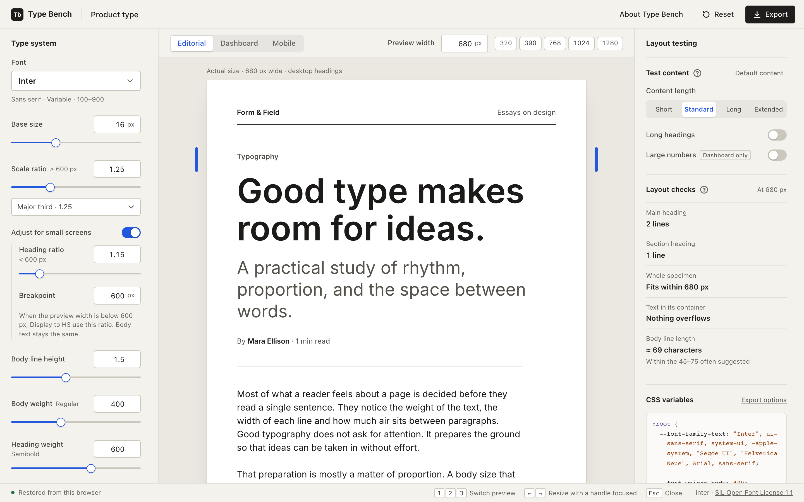
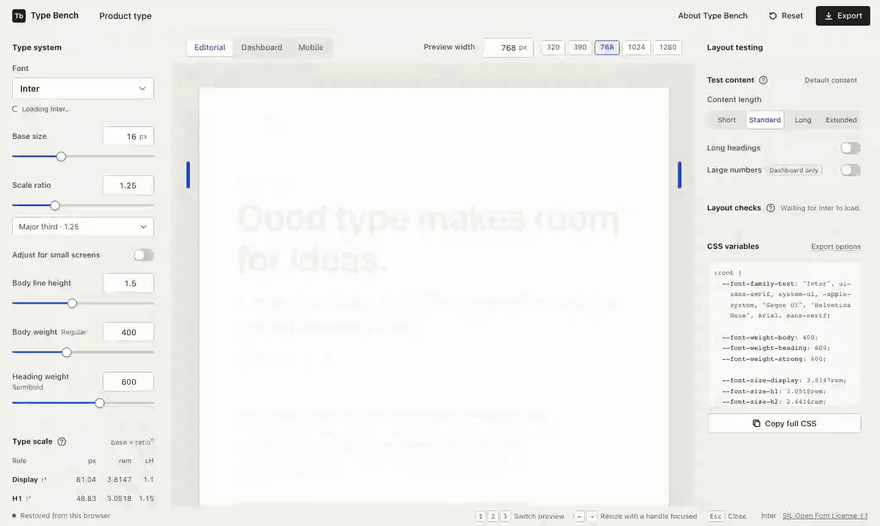

# Type Bench

Build, test and export a responsive typography system.

**[Try the live demo → type-bench.vercel.app](https://type-bench.vercel.app)**



Choose one of 12 open-source fonts, tune a modular type scale, and see it in an editorial page, a product dashboard and a mobile screen. Narrow the preview, lengthen the copy and grow the numbers to find where the type breaks, then export CSS custom properties or design tokens that match the preview exactly.

Everything runs in your browser. There is no backend, no account and no tracking, and the fonts are hosted alongside the app.

## See it work

[](docs/media/responsive-headings.mp4)

Narrow the preview to 390 px, switch on small-screen headings, lower their ratio, confirm the desktop sizes haven't moved, then export the CSS. ([MP4 version](docs/media/responsive-headings.mp4), 16 seconds.)

## Features

- **12 open-source fonts** with a searchable picker. Only weights each family actually has are offered.
- **A modular type scale**: base size, scale ratio, body line height, and separate body and heading weights.
- **Small-screen headings** (optional): a second ratio for Display to H3 below a breakpoint, applied by the preview's own width, so desktop sizes stay as they are.
- **Three realistic previews**, Editorial, Dashboard and Mobile, all driven by the same tokens.
- **Real resizing**: set a **Preview width**, pick a preset or drag the handles. The content reflows; nothing is scaled.
- **Layout testing and layout checks**: swap in longer copy, long headings and large numbers, and see measured heading line counts, overflow and line length, with each problem outlined in the preview.
- **Export** CSS custom properties or Design Tokens (DTCG) JSON, with font-loading guidance and a usage example.
- **Accessibility built in**: labelled controls, keyboard support, visible focus, live announcements and reduced-motion support. Screen-reader testing is still to come.
- **A first-use introduction** and a short "See how it works" demonstration. Your settings are saved in your browser.

More screenshots of the current interface are in [`docs/screenshots`](docs/screenshots/).

## Run it locally

You need [Node.js](https://nodejs.org/) 22.18 or later.

```bash
git clone https://github.com/aribidoolusegun/type-bench.git
cd type-bench
npm install
npm run dev        # http://localhost:5173
```

| Command | What it does |
| --- | --- |
| `npm run dev` | Starts the development server |
| `npm test` | Runs the unit tests |
| `npm run typecheck` | Checks types without building |
| `npm run build` | Type-checks, then builds a static site into `dist/` |
| `npm run preview` | Serves the production build locally |

The built site is fully static and uses relative paths, so `dist/` can be served from any static host.

## Documentation

- [Guide](docs/GUIDE.md): how sizes are calculated, using the CSS and JSON exports, what layout checks measure, keyboard shortcuts, and **known limitations**
- [Testing](docs/TESTING.md): what has and hasn't been tested
- [Changelog](CHANGELOG.md): release notes, including changes to exported files
- [Architecture](ARCHITECTURE.md): how the app is put together
- [Contributing](CONTRIBUTING.md): running the project, reporting bugs and proposing changes
- [Fonts](FONTS.md): font sources, copyright notices and licences
- [Security](SECURITY.md): how to report a vulnerability privately
- [History](docs/history/): screenshots and recordings from earlier builds, and before-and-after comparisons
- [Beta feedback guide](docs/beta/FEEDBACK-GUIDE.md): a format for a 20-minute feedback session

## Testing

The model is covered by unit tests (`npm test`). During development, scripted checks ran in the Chromium, Firefox and WebKit browser engines at desktop and phone sizes, and the creator has reported manual phone and workflow checks passing. It hasn't yet been evaluated with designers in research sessions or tested with screen readers. Details are in [docs/TESTING.md](docs/TESTING.md).

## Licence

The application code is licensed under the [MIT licence](LICENSE). The bundled fonts are **not** covered by it: each family is distributed under the SIL Open Font License 1.1, with its licence text in `public/fonts/<family>/OFL.txt`. See [FONTS.md](FONTS.md).

## Author

Designed and built by Olusegun Aribido.
